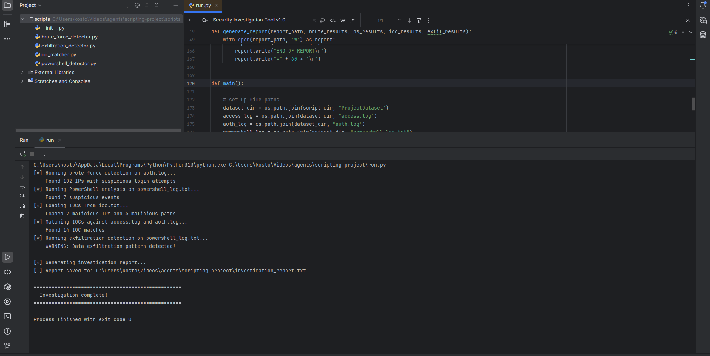

# SOC Log Analysis & Threat Detection Toolkit

A Python command-line tool that reads server and endpoint logs, detects four types of suspicious activity and writes a single investigation report, the way a SOC analyst would triage an incident.

**Individual project** · Advanced Scripting for Cyber Security · TU Dublin · April 2026
**Tech:** Python 3 (standard library only: `re`, `os`, `datetime`), regular expressions, Linux `auth.log`, Apache access logs, PowerShell logs



---

## The problem

Looking through thousands of log lines by hand to find an attack is slow and easy to get wrong. The module brief gave four log sources from a simulated incident and asked for a tool that finds the suspicious activity with one command and produces a readable report.

## What the tool does

| Detector | Log source | How it works | Severity |
|---|---|---|---|
| **Brute-force login** | `auth.log` (SSH) | Regex counts `Failed password` events per source IP, including sshd's `message repeated N times` lines so nothing is undercounted. Flags 5+ failures. | HIGH 20+, MEDIUM 10–19, LOW 5–9 |
| **Suspicious PowerShell** | `powershell_log.txt` | Keyword rules for attacker techniques (`-EncodedCommand`, `-ExecutionPolicy Bypass`, `Invoke-WebRequest`, `DownloadString`, `IEX`, hidden windows) and recon commands (`whoami`, `ipconfig`, `net user`, `systeminfo`). | HIGH / MEDIUM / LOW per rule |
| **IOC matching** | `access.log`, `auth.log` | Loads malicious IPs and web paths from `ioc.txt` and cross-checks every log line. Path matching also catches sub-paths (e.g. `/phpmyadmin/index.php`). | HIGH |
| **Data exfiltration** | `powershell_log.txt` | Looks for the pattern *archive created* (`Compress-Archive`, `.zip`, `.tar`, `.7z`) **then** *data sent out* (`-Upload`, `Invoke-WebRequest`, `curl`, `wget`). | HIGH if both seen |

`run.py` runs all four detectors, works out an overall risk level and writes `investigation_report.txt` with an executive summary followed by one section per detector.

## My contribution

This was an individual assignment. I designed and wrote all of the code:

- split the tool into one module per detector (`scripts/`), with `run.py` as the single entry point
- wrote the regular expressions for SSH and Apache log formats and handled sshd's "message repeated" lines
- chose the thresholds and severity levels and documented them in the report
- tested each detector on its own (every module has a `__main__` test block) before joining them together
- wrote the accompanying technical report (methodology, example results, conclusion)

## Results on the module dataset

Run against the real assignment dataset (~5 MB of web logs and ~800 KB of SSH logs), the tool found:

- **102** source IPs brute-forcing SSH. The worst one had **157** failed logins
- **7** suspicious PowerShell events, including an encoded command run with `-ExecutionPolicy Bypass`
- **14** IOC matches across the web and SSH logs
- a **confirmed exfiltration pattern**: `Compress-Archive` on a user's Documents folder, followed by an upload of the archive

Overall risk: **HIGH**. The screenshot above shows that run.

> The module dataset is not included in this repo because it was provided for the course. The `ProjectDataset/` folder here contains a **small synthetic sample** (it uses the RFC 5737 documentation IP ranges, so none of them are real hosts). It lets anyone run the tool and see every detector fire.

## Run it

```bash
git clone https://github.com/vsevolod-shestopalov/soc-log-analysis-toolkit.git
cd soc-log-analysis-toolkit
python run.py
```

No third-party packages are needed. Output on the sample data:

```
[*] Running brute force detection on auth.log...
    Found 3 IPs with suspicious login attempts
[*] Running PowerShell analysis on powershell_log.txt...
    Found 6 suspicious events
[*] Matching IOCs against access.log and auth.log...
    Found 8 IOC matches
[*] Running exfiltration detection on powershell_log.txt...
    WARNING: Data exfiltration pattern detected!
[+] Report saved to: investigation_report.txt
```

See [`investigation_report.txt`](investigation_report.txt) for the full sample report.

## Project structure

```
run.py                        # entry point: runs all detectors and writes the report
scripts/
  brute_force_detector.py     # SSH failed-login counting and severity
  powershell_detector.py      # malicious and recon PowerShell keywords
  ioc_matcher.py              # IOC loading and matching across logs
  exfiltration_detector.py    # archive and upload correlation
ProjectDataset/               # synthetic sample logs + ioc.txt
docs/                         # screenshot of the run on the real dataset
```

## Known limitations and what I would improve

I found these limitations while preparing this repo. I'm leaving them in the README so the code stays the version I submitted.

- **IOC IP matching in `auth.log` uses a substring check** (`if ioc_ip in line`), so the IOC `203.0.113.5` would also match `203.0.113.50`. The fix is to match whole IPs only, for example with `re.search(r"\b" + re.escape(ioc_ip) + r"\b", line)`, or by extracting the IP first, as the `access.log` check already does.
- The exfiltration detector lists `-Upload data.zip` as both an archive event and an upload event because it contains `.zip`. Correlating by timestamp, and requiring the archive event to come first, would make it more precise.
- Keyword rules are easy to evade (e.g. `iex` aliases or string concatenation). Next steps would be decoding `-EncodedCommand` payloads and mapping each finding to a MITRE ATT&CK technique (T1110 Brute Force, T1059.001 PowerShell, T1560 Archive Collected Data, T1041 Exfiltration over C2).
- Time windows: brute force is counted over the whole log, not per minute or per hour.

## Skills shown

Log analysis · threat detection logic · Python scripting and modular design · regular expressions · incident triage and reporting · Linux and Windows log formats
